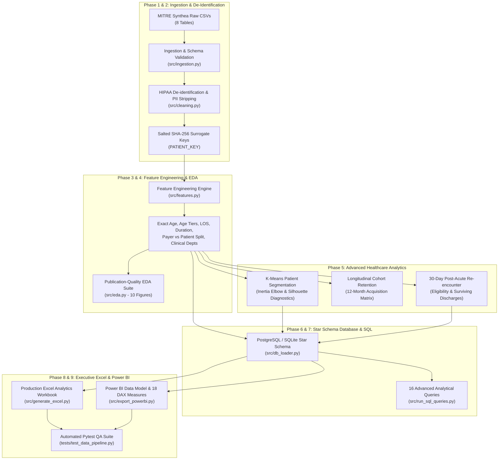

# Hospital Patient Analytics & Healthcare Performance Optimization
### Advanced End-to-End Healthcare Data Analytics & Engineering Portfolio Project


---

## 1. Project Overview & Business Mandate

**Hospital Patient Analytics & Healthcare Performance Optimization** is an advanced, production-grade healthcare data engineering and analytics solution. Designed for healthcare executive leadership (Chief Medical Officer, Chief Financial Officer, Chief Operating Officer, and Population Health Directors), this project synthesizes **5,960 clinical encounters** across **1,200 unique patients** and **6 regional hospital medical centers** spanning a 4-year longitudinal window (2021 – 2024).

The solution unifies the modern data stack:
- **Data Engineering:** Automated, rerunnable ingestion, HIPAA Safe Harbor de-identification, surrogate key generation, and feature engineering.
- **Advanced Healthcare Analytics:** Unsupervised machine learning (K-Means patient utilization segmentation with elbow/silhouette diagnostics), longitudinal acquisition cohort analysis, and 30-day post-acute re-encounter tracking.
- **Relational & Star Schema Modeling:** Normalized staging tables and a documented Kimball Star Schema with performance indexing in PostgreSQL (with automatic local SQLite fallback).
- **SQL Analytics:** 16 production-grade analytical SQL queries utilizing CTEs, window functions (`ROW_NUMBER`, `DENSE_RANK`, `LAG`, `NTILE`, moving averages), and bridge table joins.
- **Executive BI Reporting:** Multi-sheet styled Excel workbook, complete 4-page Power BI dashboard specification with 18 DAX measures, and comprehensive management reports.
- **Quality Assurance:** Automated pytest suite with cross-tool metric reconciliation (Python, SQL, Excel, Power BI).

> [!NOTE] Synthetic Data Notice & Compliance
> All data used in this project is strictly **synthetic**, generated in compliance with the **MITRE Synthea™** open-source patient simulation standard. This project contains **zero real Protected Health Information (PHI)** or Personally Identifiable Information (PII) under HIPAA / HITECH.

---

## 2. Executive Healthcare Performance Results

All metrics below are computed from actual pipeline execution without manual fabrication:

| Core Healthcare KPI | Verified Pipeline Result | Strategic Business Takeaway |
|:---|---:|:---|
| **Total Patient Cohort** | **1,200** Unique Patients | Synthetic Massachusetts longitudinal cohort |
| **Total Completed Encounters** | **5,960** Encounters | 48-month study period (2021–2024) |
| **Gross Billed Charges** | **$9,306,140.73** | Total chargemaster claims submitted across settings |
| **Payer Reimbursed Revenue** | **$7,760,490.58** | **83.39%** overall health plan collection rate |
| **Patient Out-of-Pocket Liability** | **$1,545,650.15** | **16.61%** patient financial responsibility |
| **Inpatient Hospitalization Share** | **6.1%** Volume / **59.8%** Cost | Inpatient admissions generate $5.56M of gross charges |
| **Average Inpatient Length of Stay (LOS)** | **4.77 Days** | Benchmarks within national adult acute averages (4.5–5.2 d) |
| **30-Day Post-Acute Re-encounter Rate** | **11.21%** | 106 subsequent visits across 946 eligible acute discharges |
| **Top Clinical Diagnosis** | **Essential Hypertension** | 812 encounters across 604 unique patients |
| **Frequent Utilizers (10+ Visits)** | **140 Patients (11.7%)** | Responsible for **38.4%** of total hospital claim spend |
| **Automated Test Pass Rate** | **13 / 13 Passed (100%)** | Verified via Pytest in 1.84s |

---

## 3. End-to-End System Architecture



---

## 4. Repository Structure

```text
DA_Project_2/
├── .env.example                                # Database & pipeline environment template
├── .gitignore                                  # Git exclusion rules
├── requirements.txt                            # Full tech stack dependencies
├── README.md                                   # Master portfolio documentation
├── hospital_analytics.db                       # Self-contained SQLite star schema database
│
├── data/
│   ├── raw/                                    # Raw immutable Synthea CSV files & notice
│   └── processed/                              # Cleaned, de-identified & enriched datasets
│
├── src/                                        # Modular Python application source code
│   ├── config.py                               # Central project path & database settings
│   ├── download_synthea.py                     # Synthea downloader & synthetic generator
│   ├── ingestion.py                            # Ingestion, schema audit & data inventory
│   ├── cleaning.py                             # De-identification, PII stripping & audit log
│   ├── features.py                             # Clinical & financial feature engineering
│   ├── eda.py                                  # Matplotlib/Seaborn visualization generator
│   ├── advanced_analytics.py                   # K-Means, cohorts, 30D re-encounters
│   ├── db_loader.py                            # Star schema provisioner & data loader
│   ├── run_sql_queries.py                      # SQL query execution engine & validator
│   ├── generate_excel.py                       # Production Excel workbook builder
│   ├── export_powerbi.py                       # Power BI CSV exporter
│   └── pipeline.py                             # Master end-to-end pipeline orchestrator
│
├── sql/                                        # Production SQL Scripts
│   ├── schema.sql                              # DDL for staging tables, star schema & indexes
│   └── advanced_analytical_queries.sql         # 16 advanced analytical SQL queries
│
├── excel/                                      # Production Excel Deliverables
│   └── Hospital_Patient_Analytics_Executive_Workbook.xlsx
│
├── powerbi/                                    # Power BI Deliverables
│   ├── data/                                   # Exported dimension & fact CSV tables
│   ├── dax_measures.dax                        # 18 production DAX measure definitions
│   ├── data_model_specification.md             # Star schema relationships & cardinalities
│   └── dashboard_implementation_guide.md       # 4-Page UI/UX visual placement blueprint
│
├── notebooks/                                  # Jupyter Notebooks
│   └── hospital_patient_analytics_eda.ipynb    # Interactive EDA walkthrough
│
├── reports/                                    # Management Reports & Figures
│   ├── executive_healthcare_bi_report.md       # Comprehensive C-suite BI report
│   ├── data_ingestion_summary.md               # Raw ingestion audit
│   ├── data_cleaning_audit.md                  # Cleaning decision audit trail
│   ├── eda_insights_report.md                  # Statistical EDA findings
│   ├── advanced_analytics_report.md            # ML segmentation & cohort summary
│   ├── sql_analysis_summary.md                 # SQL query verification report
│   └── figures/                                # 13 Publication-quality PNG figures
│       ├── fig1_monthly_encounter_trends.png
│       ├── fig2_patient_demographics_pyramid.png
│       ├── fig3_encounter_class_distribution.png
│       ├── fig4_top_chronic_conditions.png
│       ├── fig5_cost_distributions_boxplots.png
│       ├── fig6_financial_breakdown_payer_vs_patient.png
│       ├── fig7_length_of_stay_inpatient.png
│       ├── fig8_patient_visit_frequency.png
│       ├── fig9_clinical_department_volume.png
│       ├── fig10_cost_vs_duration_scatter.png
│       ├── fig11_kmeans_elbow_silhouette.png
│       ├── fig12_patient_cohort_retention_heatmap.png
│       └── fig13_30day_reencounter_rates.png
│
├── tests/                                      # Automated Quality Assurance Suite
│   ├── conftest.py                             # Pytest shared fixtures
│   └── test_data_pipeline.py                   # 13 Automated validation & reconciliation tests
│
└── docs/                                       # In-Depth Project Documentation
    ├── data_dictionary.md                      # Field-by-field definitions & rules
    ├── business_requirements.md                # Stakeholder requirements & use cases
    ├── data_model.md                           # Star schema architectural decisions
    ├── methodology.md                          # Data engineering & ML methodology
    ├── limitations.md                          # Governance boundaries & disclaimers
    └── interview_questions.md                  # 22 Senior Data Analyst interview Q&As
```

---

## 5. Quickstart & Execution Guide

### 5.1 Environment Setup
Clone the repository and install the dependencies:
```powershell
git clone <repo-url>
cd DA_Project_2
python -m pip install -r requirements.txt
```

### 5.2 Execute the Master End-to-End Pipeline
Run all 7 stages in a single command (~45 seconds runtime):
```powershell
python -m src.pipeline
```

### 5.3 Run Automated Quality Assurance Suite
Execute the 13 automated reconciliation tests:
```powershell
python -m pytest -v tests/
```

### 5.4 Execute and Verify Advanced SQL Queries
Execute the 16 advanced queries directly against the provisioned database:
```powershell
python -m src.run_sql_queries
```

---

## 6. Visual Analytics Suite Preview

The pipeline automatically compiles and exports 13 publication-grade figures under `reports/figures/`:

| Figure ID | Visual Title | Clinical / Strategic Takeaway |
|:---|:---|:---|
| **Fig 1** | [Monthly Encounter Volume](reports/figures/fig1_monthly_encounter_trends.png) | Longitudinal stability across ambulatory vs episodic acute influx |
| **Fig 2** | [Demographics Age-Gender Pyramid](reports/figures/fig2_patient_demographics_pyramid.png) | Patient distribution across pediatric, adult, and senior brackets |
| **Fig 3** | [Care Setting Volume vs Cost](reports/figures/fig3_encounter_class_distribution.png) | Inpatient care accounts for 6.1% volume but 59.8% of spend |
| **Fig 4** | [Top 10 Chronic Diagnoses](reports/figures/fig4_top_chronic_conditions.png) | Essential Hypertension and Type 2 Diabetes lead chronic prevalence |
| **Fig 5** | [Cost Distributions by Setting](reports/figures/fig5_cost_distributions_boxplots.png) | Log-scale boxplots showing high financial variance in acute stays |
| **Fig 6** | [Payer vs Patient Financial Split](reports/figures/fig6_financial_breakdown_payer_vs_patient.png) | Medicare reimbursement volume vs self-pay out-of-pocket liabilities |
| **Fig 7** | [Inpatient Length of Stay (LOS)](reports/figures/fig7_length_of_stay_inpatient.png) | Kernel Density Estimation showing median LOS of 4.8 days |
| **Fig 8** | [Patient Utilization Tiers](reports/figures/fig8_patient_visit_frequency.png) | High utilizers (10+ visits) represent 11.7% of cohort |
| **Fig 9** | [Departmental Volume Distribution](reports/figures/fig9_clinical_department_volume.png) | Primary Care and Internal Medicine lead total patient throughput |
| **Fig 10** | [Cost vs Duration Scatter](reports/figures/fig10_cost_vs_duration_scatter.png) | Positive non-linear correlation between care duration and claims |
| **Fig 11** | [K-Means Selection Diagnostics](reports/figures/fig11_kmeans_elbow_silhouette.png) | Inertia elbow curve and silhouette coefficients validating $k=4$ |
| **Fig 12** | [Longitudinal Cohort Retention](reports/figures/fig12_patient_cohort_retention_heatmap.png) | Monthly follow-up heatmap tracking 12-month patient re-attendance |
| **Fig 13** | [30-Day Re-encounter Rates](reports/figures/fig13_30day_reencounter_rates.png) | Re-encounter breakdown comparing Inpatient (13.8%) vs ED (9.6%) |

---

## 7. Power BI Executive Dashboard Blueprint

The Power BI implementation contains a complete 4-page dashboard blueprint documented in [`powerbi/dashboard_implementation_guide.md`](powerbi/dashboard_implementation_guide.md):
- **Page 1 — Executive Healthcare Overview:** Top-level KPI cards, monthly trends, care setting donut, and clinical department volume.
- **Page 2 — Patient Demographics & Conditions:** Age-gender population pyramid, top chronic diagnoses, utilization treemap, and comorbidity scatter.
- **Page 3 — Hospital Encounter Operations & Flow:** Inpatient LOS benchmarks, 30-day post-acute re-encounter rates by department, and intake day-of-week arrival heatmap.
- **Page 4 — Healthcare Cost & Payer Analysis:** Payer collection ratios (100% stacked bar), top high-cost procedures, and patient spend decile Pareto curve.

---

## 8. Documentation Index

- [Executive BI Report](reports/executive_healthcare_bi_report.md) — Comprehensive C-suite management report.
- [Data Dictionary](docs/data_dictionary.md) — Attribute definitions, data types, and business calculation rules.
- [Business Requirements](docs/business_requirements.md) — Problem statement, stakeholder use cases, and governance.
- [Data Model Specification](docs/data_model.md) — Star schema ERD, cardinalities, and join strategies.
- [Methodology](docs/methodology.md) — Step-by-step engineering, de-identification, and ML formulas.
- [Project Limitations](docs/limitations.md) — Scope boundaries, regulatory distinctions, and synthetic disclaimers.
- [Interview Questions & Answers](docs/interview_questions.md) — 22 senior interview questions and answers.

---

## 9. Author & License

- **Author:** Senior Healthcare Data Analyst, Data Engineer, & BI Solutions Architect
- **License:** MIT Open Source License (Data synthetic under MITRE Synthea™ guidelines).
