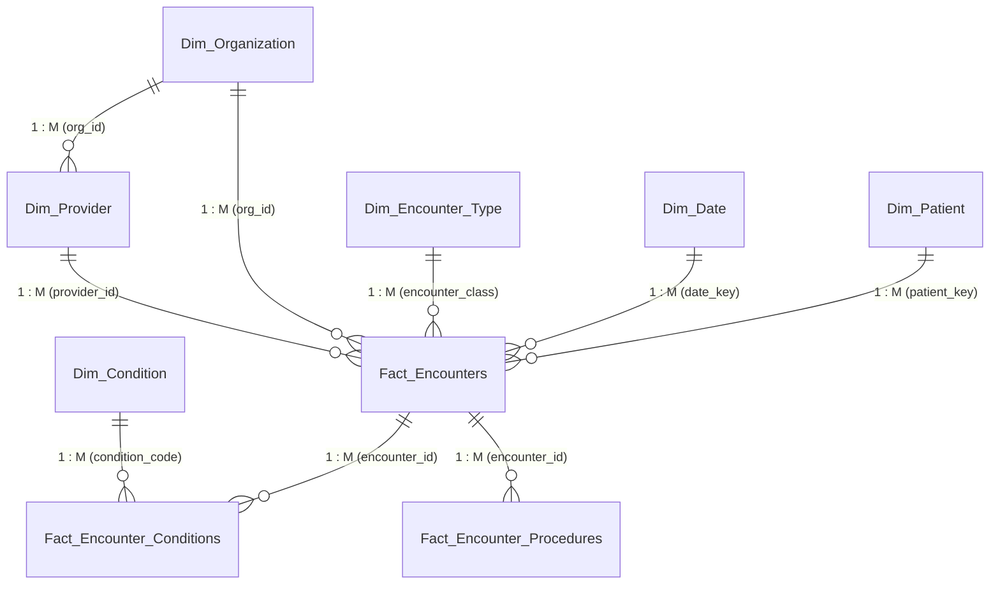

# Power BI Star Schema Data Model Specification
## Hospital Patient Analytics & Healthcare Performance Optimization

### 1. Data Model Architecture Overview
The Power BI semantic data model is designed strictly following **Kimball dimensional modeling principles** as a **Star Schema**. Fact tables contain quantifiable clinical and financial events at atomic grain, while dimension tables provide high-performance filtering, slicing, and drill-down attributes.

---

### 2. Table Relationship Matrix

| Primary Table (1 - Side) | Foreign Table (* - Side) | Primary Key Join Column | Foreign Key Join Column | Cardinality | Cross-Filter Direction | Security Filtering |
|:---|:---|:---|:---|:---:|:---:|:---:|
| `Dim_Patient` | `Fact_Encounters` | `patient_key` | `patient_key` | `1 : Many` | Single (`Dim_Patient` filters `Fact`) | False |
| `Dim_Date` | `Fact_Encounters` | `date_key` | `date_key` | `1 : Many` | Single (`Dim_Date` filters `Fact`) | False |
| `Dim_Encounter_Type` | `Fact_Encounters` | `encounter_class` | `encounter_class` | `1 : Many` | Single (`Dim_Type` filters `Fact`) | False |
| `Dim_Organization` | `Fact_Encounters` | `org_id` | `org_id` | `1 : Many` | Single (`Dim_Org` filters `Fact`) | False |
| `Dim_Provider` | `Fact_Encounters` | `provider_id` | `provider_id` | `1 : Many` | Single (`Dim_Provider` filters `Fact`) | False |
| `Dim_Organization` | `Dim_Provider` | `org_id` | `org_id` | `1 : Many` | Single (`Dim_Org` filters `Dim_Provider`) | False |
| `Fact_Encounters` | `Fact_Encounter_Conditions` | `encounter_id` | `encounter_id` | `1 : Many` | Single (`Fact_Encounters` filters `Conditions`) | False |
| `Dim_Condition` | `Fact_Encounter_Conditions` | `condition_code` | `condition_code` | `1 : Many` | Single (`Dim_Condition` filters `Conditions`) | False |
| `Fact_Encounters` | `Fact_Encounter_Procedures` | `encounter_id` | `encounter_id` | `1 : Many` | Single (`Fact_Encounters` filters `Procedures`) | False |

---

### 3. Avoiding Double-Counting in Multi-Condition Analyses
- Diagnoses and procedures exhibit a **one-to-many** relationship with clinical encounters (a single hospital visit often records 3–5 diagnoses and 1–3 procedures).
- Directly joining `Fact_Encounters` and `Fact_Encounter_Conditions` on `encounter_id` without grouping duplicates financial claim amounts (`total_claim_cost`).
- **Data Modeling Solution:** 
  - `Fact_Encounters` serves as the primary transaction fact holding financial metrics at the encounter level.
  - `Fact_Encounter_Conditions` and `Fact_Encounter_Procedures` serve as secondary bridge/event facts.
  - All financial measures (`[Gross Billed Charges]`, `[Total Payer Reimbursement]`) evaluate strictly on `Fact_Encounters`.
  - Condition counts (`[Diagnosed Chronic Condition Count]`) evaluate on `Fact_Encounter_Conditions`.

---

### 4. Storage Mode & Refresh Architecture
- **Storage Mode:** Import Mode (in-memory VertiPaq engine).
- **Partitioning:** Partitioned by `Dim_Date[year]` (2021, 2022, 2023, 2024).
- **Date Dimension:** Marked as official Date Table in Power BI (`full_date`).
