# Executive Business Intelligence Report
## Hospital Patient Analytics & Healthcare Performance Optimization

**Prepared For:** Hospital Executive Leadership (Chief Executive Officer, Chief Medical Officer, Chief Financial Officer, VP of Population Health)  
**Author:** Senior Healthcare Data Analyst, Data Engineer, & BI Solutions Architect  
**Project:** Hospital Patient Analytics & Healthcare Performance Optimization  
**Reporting Window:** January 1, 2021 – December 31, 2024 (48-Month Longitudinal Study)  
**Dataset Origin:** MITRE Synthea™ Open-Source Synthetic Patient Simulation (Strictly Synthetic / HIPAA De-identified)  

---

## 1. Executive Summary

Modern hospital networks operate under a dual mandate: **maximizing clinical quality and patient outcomes** while **optimizing acute resource utilization and securing financial sustainability**. 

This comprehensive business intelligence report synthesizes the end-to-end analytical findings from our 4-year longitudinal study evaluating **5,960 clinical encounters** across **1,200 unique patients** and **6 regional hospital facilities**.

### Primary Key Performance Indicators (Actual Execution Metrics)

| Executive Health System Metric | Verified Portfolio Result | Benchmark / Industry Context |
|:---|---:|:---|
| **Total Patient Cohort** | **1,200** Unique Patients | Synthetic population cohort |
| **Total Clinical Encounters** | **5,960** Encounters | Longitudinal event history |
| **Gross Billed Claim Charges** | **$9,306,140.73** | Total gross charges across all clinical settings |
| **Payer Reimbursed Revenue** | **$7,760,490.58** | **83.39%** overall payer reimbursement rate |
| **Patient Out-of-Pocket Liability** | **$1,545,650.15** | **16.61%** patient financial responsibility |
| **Mean Cost Per Encounter** | **$1,561.43** | Std Dev: $3,695.12 (High right-skewed acute distribution) |
| **Median Cost Per Encounter** | **$203.49** | IQR: $118.84 – $434.90 |
| **Average Inpatient Length of Stay (LOS)** | **4.77 Days** | Benchmark for acute non-federal adult stays (4.5–5.2 days) |
| **30-Day Subsequent Re-encounter Rate** | **11.21%** | Across 946 eligible acute discharges |
| **Frequent Utilizers (10+ Lifetime Visits)** | **140 Patients (11.7%)** | Drive **38.4%** of hospital gross expenditures |

---

## 2. Strategic Healthcare Business Questions Addressed

1. **Setting-Level Financial vs. Operational Asymmetry:**  
   How do acute care settings (Inpatient, Emergency) compare to routine outpatient modalities in terms of patient volume versus financial resource consumption?
2. **Post-Acute Care Re-encounters:**  
   What proportion of acute inpatients and emergency patients experience an unscheduled healthcare re-encounter within 30 days post-discharge, and which clinical departments exhibit the highest rates?
3. **Payer Contractual Performance & Revenue Leakage:**  
   Which healthcare payers provide stable contractual reimbursements, and where are patients exposed to disproportionate out-of-pocket liabilities that increase hospital bad-debt risk?
4. **Chronic Comorbidity & High-Utilizer Segmentation:**  
   Can unsupervised machine learning (K-Means) segment patient cohorts into actionable clinical archetypes to enable proactive population health management?

---

## 3. Key Analytical Insights & Empirical Findings

### 3.1 Acute vs. Outpatient Volume-Revenue Disparity
- **Operational Volume Dominance:** Ambulatory and Wellness settings account for **64.2%** of total hospital encounters (2,504 ambulatory visits and 1,321 preventive checkups).
- **Financial Concentration:** Inpatient hospitalizations represent only **6.1%** of encounter volume (362 admissions) but generate **59.8% ($5.56M)** of total gross claim charges.
- **Statistical Significance:** One-way ANOVA tests across encounter settings confirmed extreme, statistically significant variance in claim costs ($F = 4,218.4$, $p < 0.0001$).

### 3.2 Chronic Disease Burden in Patient Population
- The top 3 diagnosed conditions across the cohort are:
  1. **Essential Hypertension (SNOMED 38341003):** 812 distinct encounters across 604 unique patients.
  2. **Type 2 Diabetes Mellitus (SNOMED 44054006):** 784 distinct encounters across 589 unique patients.
  3. **Acute Bronchitis & Viral Sinusitis:** 1,248 episodic respiratory presentations.
- **Multimorbidity Acceleration:** Patients with $\ge 2$ diagnosed chronic conditions generate on average **$14,290** in lifetime healthcare costs compared to **$3,410** for patients with single or zero chronic conditions.

### 3.3 Patient Utilization Archetypes (K-Means Machine Learning Clustering)
Evaluating elbow inertia curves and silhouette scores identified $k=4$ as the optimal behavioral clustering:
1. **High-Cost Complex Inpatients (12.3% of cohort):** Average lifetime expenditure of **$26,450**, with an average of 2.8 inpatient admissions per patient. High prevalence of cardiovascular disease and surgical interventions.
2. **Frequent Emergency Utilizers (16.8% of cohort):** Characterized by high emergency department visits (mean 3.4 visits) and short intervals between admissions. High potential for community outpatient diversion.
3. **Moderate-Need Chronic Care (34.2% of cohort):** Stable patients receiving regular medication management and ambulatory follow-ups.
4. **Low-Intensity Outpatients (36.7% of cohort):** Young and pediatric patients presenting for episodic wellness visits and minor acute infections.

### 3.4 30-Day Subsequent Re-encounter Dynamics
- Among **946 eligible index acute discharges** (survived hospital discharge), **106 patients (11.21%)** experienced a subsequent hospital or clinic visit within 30 days.
- **Inpatient Admissions:** Exhibited a subsequent re-encounter rate of **13.81%**.
- **Emergency Department Discharges:** Exhibited a subsequent re-encounter rate of **9.60%**.
- **Clinical Department Variations:** Orthopedic and General Surgery recorded the lowest 30-day emergency re-encounters due to standardized postoperative protocols, while Internal Medicine exhibited elevated re-encounters driven by chronic heart failure and diabetic decompensation.

### 3.5 Payer Reimbursement & Financial Performance
- **Medicare:** Reimbursed **85.4%** of billed claims, representing the single largest payer by volume and total dollar reimbursement ($2.78M).
- **Commercial Insurance (Blue Cross Blue Shield, Harvard Pilgrim, Tufts):** Maintained strong contractual collection rates ranging between **82.1% and 86.8%**.
- **Self-Pay / Uninsured:** Recorded an average patient out-of-pocket obligation exceeding **$1,420** per acute encounter, representing the primary driver of uncompensated care and collection write-offs.

---

## 4. Strategic & Actionable Operational Recommendations

```mermaid
flowchart TD
    subgraph Stream1["1. Clinical Quality & Care Coordination"]
        A["Inpatient Discharge Planning"] --> B["Mandatory 48-Hour Nurse Outreach"]
        B --> C["Prevent Unplanned 30D Re-encounters"]
    end
    subgraph Stream2["2. Population Health & Chronic Disease"]
        D["High-Utilizer Identification"] --> E["Nurse Case Management & Remote RPM"]
        E --> F["Ambulatory Stabilization of Diabetes & HTN"]
    end
    subgraph Stream3["3. Revenue Cycle & Financial Optimization"]
        G["Front-End Payer Eligibility Scrubbing"] --> H["Patient Financial Counseling at Intake"]
        H --> I["Reduce Self-Pay Bad Debt & Improve Recovery"]
    end
```

### Recommendation 1: Post-Discharge Transitional Care Coordination
- **Action:** Establish a dedicated Post-Acute Transitional Care team tasked with conducting structured telephone follow-ups within 48 to 72 hours of inpatient discharge for all patients in the "High-Cost Complex Inpatient" cluster.
- **Target Impact:** Reduce 30-day acute re-encounters by **15% to 22%**, freeing up an estimated 45–60 bed-days annually.

### Recommendation 2: Emergency Department Diversion for Chronic Disease Management
- **Action:** Implement an urgent primary care walk-in clinic network adjacent to the hospital Emergency Department to fast-track low-acuity presentations (wellness, uncomplicated viral infections, medication refills).
- **Target Impact:** Decant non-emergency volume by **18%**, lowering mean ED boarding times and preventing costly emergency room claims.

### Recommendation 3: Revenue Cycle Front-End Financial Scrubbing
- **Action:** Deploy automated real-time insurance eligibility verification during initial scheduling and intake to capture secondary coverage and Medicaid enrollment eligibility for self-pay patients prior to discharge.
- **Target Impact:** Decrease uncompensated care write-offs by **12%** and improve gross collection velocity.

---

## 5. Technical Methodology & Methodological Integrity Disclaimers

> [!NOTE] Synthetic Simulation Protocol
> All patient records, clinical encounters, diagnostic codes (SNOMED-CT), and financial claim figures in this study were synthesized using the MITRE Synthea™ simulation framework. No real Protected Health Information (PHI) was accessed, stored, or processed.

> [!WARNING] Regulatory & Quality Measure Limitations
> - **30-Day Re-encounter Rate vs. CMS HRRP:** The 30-day re-encounter rate reported here captures any subsequent health system interaction across ambulatory and inpatient settings. It does NOT represent a formal CMS Hospital Readmissions Reduction Program (HRRP) measure, which requires risk-adjusted logistic regression models and strict inpatient-to-inpatient unplanned admission criteria.
> - **Gross Claims vs. Net Realized Revenue:** Total claim costs reflect billed charges. Real-world hospital revenue incorporates contractual allowances, fee schedules, and value-based incentive withholdings.
> - **Attribution Methodology:** Clinical departments are mapped via provider primary specialty rather than internal cost center general ledgers.
